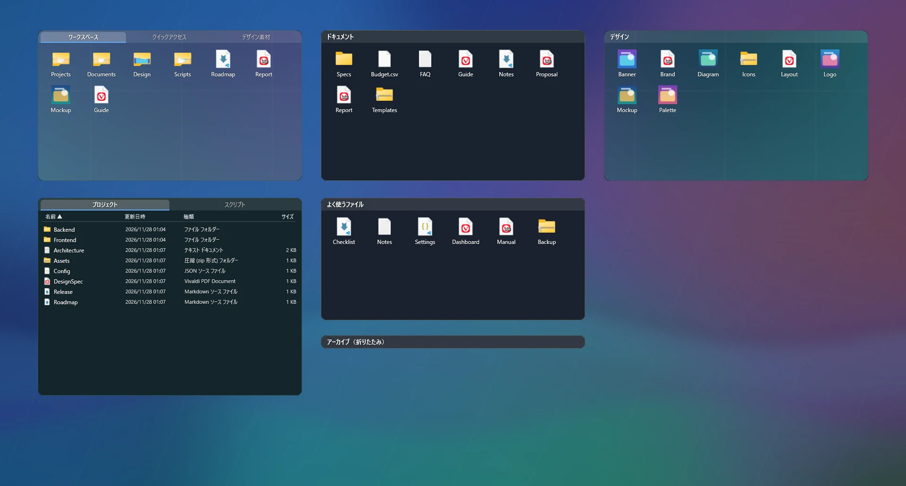
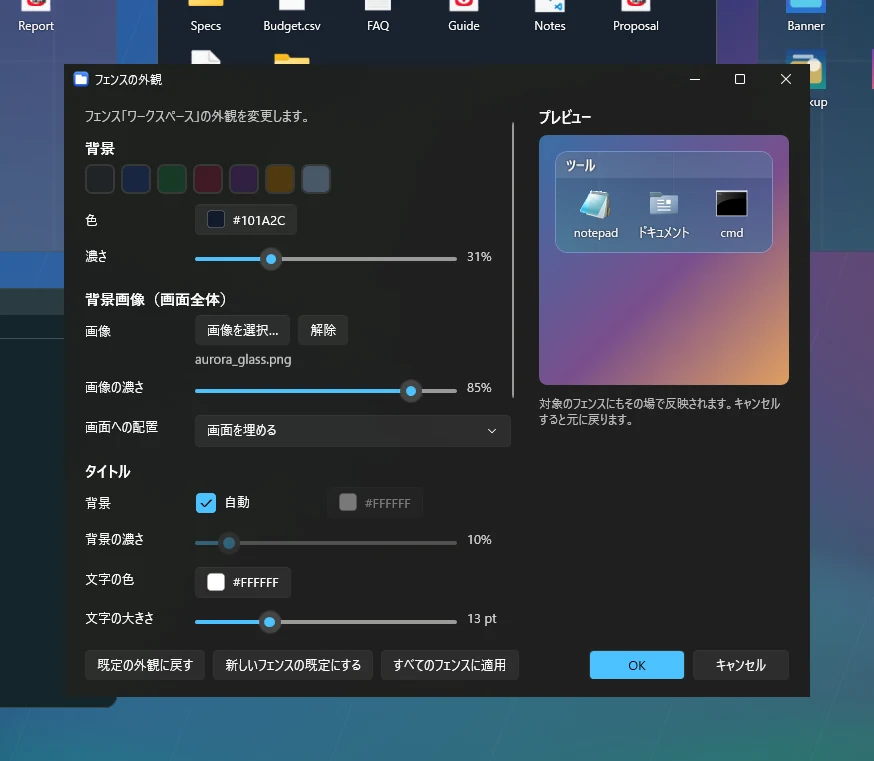

<p align="center">
  
</p>

# Fako（ファーコ）


デスクトップのアイコンを、半透明の「フェンス」にまとめて整理する Windows 用アプリです。
フェンスはデスクトップの最背面に常駐し、壁紙の上に置いたまま使えます。

- **ファイルを動かさない** — フェンスはパスを覚えるだけ。ファイルの属性も変えません。
- **エクスプローラーに組み込まない** — 独立したアプリなので、Explorer を不安定にしません。
- **常駐しても軽い** — 使っていないときはイベントを待つだけで、CPU はほぼ 0% です。



## 主な機能

| 機能 | 内容 |
|---|---|
| フェンス | 半透明の枠。タイトルをドラッグで移動、端をドラッグでサイズ変更。常にデスクトップの最背面 |
| ショートカット | ファイル／フォルダーをドロップして登録。実体は移動しない |
| フォルダーポータル | 指定フォルダーの中身をそのまま表示。変更は自動で反映 |
| 未整理 | どのフェンスにも入っていないデスクトップの項目（ごみ箱などのシステム項目も）。外からドロップするとデスクトップへ移動／コピー |
| SSH | SFTP でつないだ先のフォルダーを表示・操作。アップロード／ダウンロード、保存時の自動アップロード、ターミナルで開く |
| 最近のファイル | 既定で 24 時間以内に更新されたファイルを仮想フェンスに表示（デスクトップ・ダウンロード・スクリーンショット）。表示専用 |
| タブ | 1 つのフェンスに複数ページ。追加・切り離し・結合・並べ替え |
| 表示・並べ替え | 特大／大／中／小アイコン、一覧、詳細、並べて表示。名前／更新日時／種類／サイズで並べ替え。ショートカット型は手動順も可 |
| キーボード | 文字入力で名前ジャンプ、矢印キーの追従スクロール、Tab／Shift+Tab で隣のフェンスへ |
| 検索 | `Ctrl+F` でフェンス内を絞り込み、`Ctrl+Alt+F` で全フェンス横断検索 |
| Peek | `Ctrl+Alt+Space` でフェンスを一時的に全ウィンドウの上へ |
| プライバシー | マウスを乗せるまで中身と名前をぼかす。画面共有向け |
| シングルクリック | 設定で、アイコンの 1 回クリックで開くようにできる |
| スナップ | 移動・サイズ変更時に、近くのフェンスの端と画面端へ吸着（Alt 押下中は無効） |
| 自動振り分け | 拡張子・名前・種類・正規表現のルールで、新しい項目を自動でフェンスへ。プリセットで定番の分類をまとめて追加 |
| まとめ移動 | `Ctrl+Shift+クリック` で選んだ複数のフェンスをまとめて移動 |
| 元に戻す | `Ctrl+Z` で「フェンスから外す」「フェンス間の移動」を戻す |
| 設定の入出力 | フェンスの配置・外観・自動振り分けなどを JSON に書き出し／読み込み（SSH の保存済みパスワードは含まない） |
| 外観 | 背景色・画面固定の背景画像・タイトル・枠・角の丸み・文字をフェンスごとに調整。設定画面から一括適用も可能 |
| 常駐 | タスクトレイに常駐。設定で Windows 起動時の自動開始も可能 |

### 操作のポイント

- アイテムはダブルクリック／`Enter` で開く、`Delete` でフェンスから外す、`F5` で更新。
- アイテムのない所をドラッグすると範囲選択で複数選べます（`Ctrl`／`Shift` で追加選択）。
- アイテムの右クリックは Windows 標準（エクスプローラーと同じ）のメニュー。送る・削除・プロパティなどがそのまま使えます。
- フェンスの右クリックから、表示／並べ替え／タブ／色／外観の設定／削除など。
- タイトルをダブルクリックで折りたたみ。マウスを乗せると一時的に開きます。
- デスクトップの何もない所をダブルクリック（またはトレイを左クリック）で、フェンスを一括で隠す／表示。
- エクスプローラーへドラッグするとコピーになります（移動はしません）。
- SSH は `~/.ssh/config` の Host を選べます。認証は SSH エージェント（Bitwarden・1Password・KeePassXC・Windows 標準の `ssh-agent`）・鍵ファイル・パスワードに対応しています。初回接続時にホスト鍵の指紋を確認し、以後鍵が変わると接続を拒否します。
- SSH フェンスのファイルをダブルクリックすると一時フォルダーにダウンロードして開き、保存すると自動でアップロードします。

背景画像は外観の設定から選択できます。画像は仮想デスクトップ全体に固定され、フェンスと重なる部分だけが表示されます。移動やリサイズで画像自体は動きません。画像は設定フォルダーの backgrounds にコピーされます。設定の JSON 書き出しには画像本体は含まれません。



## インストール

1. [Releases](https://github.com/sugurunatsuno/Fako/releases) から最新版の `Fako-...-win-x64.zip` をダウンロードします。
2. 好きな場所に展開します（例: `C:\Tools\Fako`）。
3. `Fako.exe` を実行します。

- **.NET のインストールは不要です**（自己完結版）。初回起動だけ展開のため数秒かかることがあります。
- 展開せずに ZIP の中から直接実行しないでください。
- 署名のないアプリのため、初回に「Windows によって PC が保護されました」と表示されることがあります。
  「詳細情報」→「実行」を選んでください。または exe を右クリック →「プロパティ」→「ブロックの解除」にチェック → OK。
- タスクトレイにアイコンが出ます（Windows 11 では最初「^」の中）。タスクバーへドラッグすると常に表示できます。

## はじめの設定

1. トレイのアイコンを右クリック →「設定…」を開きます。
2. 「全般」で「デスクトップのアイコンをフェンスで管理する」を選びます。
   Windows 標準のデスクトップアイコンを隠し、表示をフェンス側で行います。**ファイル自体は変更しません。**
3. 必要なら「Windows の起動時に Fako を開始する」にチェックします。
4. フェンスを作ります（トレイのメニューから）。
   - 「新しいフェンス」
   - 「未整理フェンスを追加」
   - 「フォルダーポータルを追加…」
   - 「SSH フェンスを追加…」
5. 未整理フェンスから、各フェンスへアイコンをドラッグして仕分けします。

自動振り分けを使う場合は、設定 →「自動振り分け」→「プリセット…」→「おすすめセットを追加」で、
画像・動画・音声・ドキュメント・圧縮ファイル・プログラムのフェンスとルールをまとめて作れます。

画面共有時に中身を隠したいときは、トレイまたは設定 →「全般」で「プライバシーモード」をオンにします。

## 主なショートカット

| 操作 | ショートカット |
|---|---|
| フェンス内を検索 | `Ctrl+F` |
| 全フェンスを横断検索 | `Ctrl+Alt+F` |
| フェンスを一時的に前面へ（Peek） | `Ctrl+Alt+Space` |
| 元に戻す | `Ctrl+Z` |
| タブを切り替え | `Ctrl+Tab` / `Ctrl+Shift+Tab` |
| 隣のフェンスへ移動 | `Tab` / `Shift+Tab` |
| 複数のフェンスを選択 | `Ctrl+Shift+クリック` |
| アイコンサイズを切り替え | `Ctrl+ホイール` |
| 最新の情報に更新 | `F5` |
| アイテムを開く | `Enter`（またはダブルクリック） |
| フェンスから外す | `Delete` |
| 名前を変更（SSH） | `F2` |
| 検索を閉じる | `Esc` |

文字を入力すると名前でジャンプします。同じ文字の連打で次の候補へ移り、ひらがな／カタカナ・全角／半角は区別しません。

## 更新

- 起動時に GitHub の Releases を確認し、新しい版があれば通知します（設定でオフにできます）。
- 通知からダウンロードすると、そのまま再起動して更新します。SHA-256 が公開されている場合は検証します。
- 手動で確認するには、設定 →「情報」→「今すぐ確認」。
- 「いいえ」を選んだ版は自動通知しません。手動で確認すれば更新できます。

## データの場所

| 内容 | 場所 |
|---|---|
| 設定 | `%APPDATA%\Fako\config.json` |
| ログ | `%APPDATA%\Fako\fako.log` |
| SSH の一時ファイル | `%TEMP%\Fako\sftp\` |
| 自動起動の登録 | `HKCU\Software\Microsoft\Windows\CurrentVersion\Run` の `Fako` |

トレイの「設定フォルダーを開く」からも開けます。バックアップは `config.json` をコピーするか、設定 →「情報」→「書き出す…」を使います。
アンインストールは、Fako を終了して展開したフォルダーと `%APPDATA%\Fako` を削除してください（自動起動をオンにしていた場合は先にオフにします）。

> 旧名 Kakoi の設定がある場合は、初回起動時に `%APPDATA%\Fako` へ引き継ぎます。

## ソースからビルド

.NET 10 SDK が必要です。

```powershell
# ビルドして %LOCALAPPDATA%\Programs\Fako に配置し、起動
.\install.ps1

# 配布用（自己完結・単一ファイル）
dotnet publish src\Fako -c Release -r win-x64 --self-contained true `
    -p:PublishSingleFile=true -p:IncludeNativeLibrariesForSelfExtract=true -o dist
```

フレームワーク依存にすれば小さく作れます（.NET 10 Desktop Runtime が必要）。

```powershell
dotnet publish src\Fako -c Release -r win-x64 --self-contained false -p:PublishSingleFile=true -o dist
```

## ドキュメント

- [DOCUMENTATION.md](DOCUMENTATION.md) — 設計、機能の詳細、性能測定、実装メモ
- [はじめにお読みください.md](はじめにお読みください.md) — 短い導入ガイド
- [TESTING.md](TESTING.md) — 自動テスト・スモークテスト・手動確認のチェックリスト
- [docs/RELEASING.md](docs/RELEASING.md) — リリース手順と CI/CD
